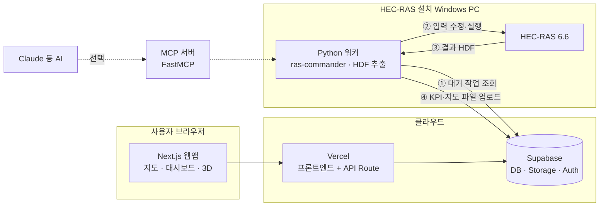

# 힌남노 냉천 내·외수 침수 웹서비스 — 프로젝트 가이드라인

> **과제명** 바이브 코딩을 활용한 수리·수문 모델 기반 웹앱 개발 및 배포
> **과목** CVLE0764 개수로 및 유사이동론 (김병현 교수님) · 2026-2학기
> **작성** 장혜리 (경북대학교 토목공학과) · v2 2026-10-16 (보유 HEC-RAS 모형 확인 반영) · 2026-10-19 작업 폴더로 이동
> **대상** 포항 냉천 유역 — 2022년 태풍 힌남노
> **서비스명(가칭)** 힌남노 침수 다시보기 — *Hinnamno Flood Replay*

---

## 0. 이 문서의 용도

- 이 프로젝트의 **뼈대(Single Source of Truth)**. 기능을 추가하거나 방향을 바꾸면 이 문서를 먼저 고친다.
- 바이브 코딩 시 AI 에이전트(Claude Code 등)에게 주는 **컨텍스트 원천**. 저장소를 만들면 이 문서를 `docs/GUIDE.md`로 넣고, 요약본을 `CLAUDE.md`로 둔다(§9).
- `[확인 필요]` 표시는 아직 정해지지 않은 항목이다(§12).
- **실행 순서·체크리스트·기록**은 같은 폴더의 `01_작업 진행 가이드.md`, AI 활용 내역은 `02_AI 활용 기록.md`에서 관리한다.
- 작업 폴더: `과제_힌남노 침수 웹서비스\` (1. 과정 / 2. 결과 보고서 / 3. 발표자료 / 4. github)
- **v2 변경점**: §4.1에 실제 모형(`C:\Hec-Ras\KNUWATER\Pohang`) 구성·결과·점검사항을 채우고, 그에 맞춰 입력조건(§4.2.3), 실행 연계(§4.3), 데이터 용량(§5.1), 리스크(§10)를 고쳤다.

---

## 1. 프로젝트 정의

### 1.1 한 줄 정의

> 2022년 태풍 힌남노 때 포항 냉천 유역의 **HEC-RAS 1D–2D 외수·내수 침수해석**을 웹에서 **조건 설정 → 실행 → 지도/3D 시각화 → 시나리오 비교**까지 할 수 있게 연결하고, 일반 시민도 **"어디가, 언제, 얼마나" 잠겼는지** 지도와 3D로 볼 수 있게 공개하는 웹서비스.

### 1.2 문제 정의 4요소 (세미나 *Lessons Learned* 틀)

| 요소 | 이 프로젝트에서의 답 |
|---|---|
| **PROBLEM** | 냉천 범람(외수)과 맨홀 월류(내수)가 겹친 복합 침수를, 전문가는 원인·조건별로 분석하고 시민은 직관적으로 이해할 수 있게 한다 |
| **DATA** | HEC-RAS 6.6 모형·결과(HDF), 상류·측방 유입 수문곡선, 하류 조위, 맨홀 월류 유량, 흔적수위·침수흔적도, 2 m DEM |
| **DOMAIN LOGIC** | 외수 단독(NC090901) vs 외수+내수 복합(NC090902) 비교로 내수 기여 분리, 유입·월류량·조위 변화에 따른 침수심·범위·도달시간 해석 |
| **VALIDATION** | 흔적수위·침수흔적도와 비교, 웹 표출값과 HEC-RAS 원본 일치 확인, 체적오차 점검 (§4.5) |

### 1.3 두 종류의 사용자

| 구분 | 분석 모드 (과제 핵심) | 시민 모드 (확장: 침수 알림 서비스) |
|---|---|---|
| 대상 | 교수님·연구자·실무자 | 일반 시민, 지역 주민 |
| 할 수 있는 것 | 조건 설정, 모델 실행, KPI·시계열·시나리오 비교 | 주소 검색, 우리 동네 최대 침수심, 시간대별 재현, 3D 보기 |
| 모델 실행 | 가능 (로그인 사용자) | 불가 — 계산된 결과만 조회 |

### 1.4 세미나 틀에 맞춘 위치

세미나의 **DATA · MODEL · SPACE** 세 사례를 이 프로젝트 하나에 담는다.

- **DATA** → 힌남노 유입·조위·맨홀 월류·흔적 자료 대시보드
- **MODEL** → HEC-RAS를 웹·AI(MCP)에서 실행하는 연계
- **SPACE** → 2D 지도 + 3D 침수 재현 (*Map as an Interface*)

---

## 2. 과제 요구사항 ↔ 우리 계획 대응표

### 2.1 주요 과제 내용 ①~⑤

| 과제 항목 | 요구 내용 | 이 프로젝트의 대응 | 본문 |
|---|---|---|---|
| ① 모델 선정 | 오픈소스 또는 전문 프로그램, 자유 주제 | **HEC-RAS 6.6 1D–2D** — 냉천 힌남노 외수·내수 복합 침수 | §4.1 |
| ② 바이브 코딩 웹앱 | 생성형 AI로 구현, 입력·모의조건 설정/변경, 실행, 사용자 친화 UI | Claude Code로 Next.js 웹앱, 조건 설정 패널 + 실행 버튼 + 작업 상태 | §4.2 |
| ③ 모델 연계 | 전문 프로그램을 API·CLI·스크립트로 실행 / (선택) MCP | Python 워커가 `ras-commander`로 HEC-RAS 실행, HDF에서 결과 추출 / FastMCP 서버(선택) | §4.3 |
| ④ 대시보드 | KPI, 시계열·공간분포 지도·지점별 결과, 시나리오 비교, 상호작용 | 침수면적·수심등급·침수시작시각·하천 첨두유량·월류량 KPI, 2D/3D 지도, 시간 슬라이더, 스와이프·차이지도 | §4.4 |
| ⑤ 검증·배포 | 기준 결과와 비교 검증, 클라우드 배포, 웹에서 실행~분석 | 흔적수위·침수흔적도 검증, Vercel + Supabase + 계산 워커 | §4.5 |

### 2.2 핵심 요구사항 5단계 (웹에서 전 과정 구현)

| 단계 | 구현 방식 | 정적 대시보드가 아닌 근거 |
|---|---|---|
| (1) 모의조건 설정 | 상류·측방 유입 배율, 맨홀 월류량 배율, 하류 조위 보정, 조도계수 배율, 외수/복합 선택 | 값을 바꾸면 새 작업이 만들어짐 |
| (2) 모델 실행 | 작업 대기열 → Windows 워커가 HEC-RAS 실제 실행 (**1회 전체 6~9분**, 1D 후처리 포함 — §4.1.2, 11/2 웹 실행 시험 8분 39초. 끄면 약 4분이지만 정석대로 켜기로 함, 11/2 결정) | 실행 로그·진행 상태·계산 시간이 웹에 표시됨 |
| (3) 결과 시각화 | KPI 카드, 2D 침수심 지도, 3D, 시계열 | 새 실행 결과가 자동으로 대시보드에 반영됨 |
| (4) 시나리오 비교 | 두 시나리오 스와이프·차이지도·KPI 증감표 | 사용자가 고른 임의의 두 결과를 비교 |
| (5) 웹 서비스 배포 | 외부 접속 URL | 교수님이 URL로 직접 접속해 실행 가능 |

### 2.3 최종 제출물

| 제출물 | 준비 내용 | 본문 |
|---|---|---|
| 웹앱 URL | Vercel 배포 주소 (분석 모드 데모 계정 포함) | §4.5 |
| GitHub 저장소 | https://github.com/janghyeri/HEC-RAS — `web/`, `worker/`, `pipeline/`, `mcp/`, `docs/` | §5.3 |
| 결과보고서 (5쪽 이내) | 모델 개요 · 시스템 구성 · AI 활용 과정 · 주요 기능 · 검증 결과 | §8.1 |
| 시연 발표 (5–10분) | 입력조건 설정 → 모델 실행 → 대시보드 → 시나리오 비교 | §8.2 |

### 2.4 평가 기준과 집중 포인트

| 평가항목 | 배점 | 점수를 받는 근거 |
|---|---|---|
| 수리·수문 모델의 적절성 및 공학적 정확성 | 25 | 외수/복합 분리의 수리학적 타당성, 흔적수위·침수흔적도 검증, 체적오차 점검 |
| 기존 모델 연계 및 실제 구동 수준 | 25 | **발표 중 웹에서 HEC-RAS가 실제로 돌고 결과가 뜨는 것**을 시연 (1회 약 9분 — 발표 앞부분에 실행을 걸어 둠) |
| 모의 결과 대시보드 및 시각화 완성도 | 20 | KPI·지도·시계열·비교 + 3D 재현 |
| 바이브 코딩 및 생성형 AI 활용 역량 | 15 | AI 활용 기록, MCP 자연어 실행(가점) |
| (5번째 항목) | 15 | 과제 PDF에 4번째 항목과 같은 이름으로 중복 표기 — 배포·서비스 완성도로 추정, **교수님께 확인** `[확인 필요]` |

> MCP·AI 에이전트 연계는 선택이지만 완성도가 높으면 **가점**. 참고 발표자료 *MCP를 이용한 SWMM 매개변수 최적화*처럼 HEC-RAS용 MCP 도구를 만들면 차별점이 된다.

---

## 3. 전체 시스템 구성



**왜 이 구조인가**

- HEC-RAS 계산은 Windows 설치 PC에서 돈다. **PC의 워커가 클라우드 DB를 주기적으로 조회해 작업을 가져가는(pull) 방식**으로 연결한다.
  - PC에 외부 포트를 열 필요가 없다(보안·학교망 문제 회피).
  - 상태는 "대기 → 실행 중 → 완료"로 웹에 표시한다.
- 부정류 계산 자체는 짧고(외수 약 1.5분, 복합 약 2.5~3분 — 24코어) 전체 과정은 후처리 포함 6~8분이라 **요청 즉시 실행**이 현실적이다 (§4.1.2).
- 워커가 꺼져 있어도 서비스가 멈추지 않도록 **사전 계산 시나리오 라이브러리**를 함께 제공한다.
- 강의자료 스택(Next.js · Supabase · Shadcn · Vercel)을 따라 AI가 익숙한 구조로 만든다.

---

## 4. 과제 순서별 진행 계획

### 4.1 ① 수리·수문 모델 선정 — 보유 HEC-RAS 모형 (확인 완료)

#### 4.1.1 파일 구성

- 모형 폴더 (원본): `C:\Hec-Ras\KNUWATER\Pohang` — 수정하지 않음
- 웹 실행용 기준 복사본: **`C:\Hec-Ras\HECRASMCP\Pohang_web`** — HEC-RAS가 영어 경로에서 안정적으로 실행되므로 워커·스크립트는 이 위치를 쓴다 (2026-10-19)

| 폴더/파일 | 내용 |
|---|---|
| `NC090901\` (프로젝트 `NC0909.prj`) | **외수 침수** — 하천 유입·조위만 |
| `NC090902\` (프로젝트 `NC090902.prj`) | **외수 + 내수 침수** — 위 조건 + 맨홀 274개 월류 유량 |
| 공통 계획 | `p03` "Unsteady flow_Hin Namno" = 지오메트리 `g03` (NC+SK_unsteady) + 부정류 `u01` |
| 결과 | `NC0909.p03.hdf` (91 MB), `NC090902.p03.hdf` (113 MB) |
| 지형 | `NC090901\Terrain\Terrain.hdf` / `Terrain.all.tif` — NC090902도 `..\NC090901\Terrain`을 참조 |
| 맨홀 | `node.dss` (맨홀 유량, 10분), `final manhole.shp` (21,567점), `NC090901\manhole change.shp` (1,284점) |

> **폴더 구조 유지 주의**: NC090902는 지형을 `..\NC090901\Terrain`, 맨홀 유량을 `..\node.dss`로 상대경로 참조한다(기준 복사본은 맨홀 유량을 u01 표로 전환해 `node.dss`가 필요 없음). 옮기거나 작업 폴더를 만들 때 `Pohang_web` 폴더째 복사한다. 경로에는 한글을 쓰지 않는다.

#### 4.1.2 모형 구성 (HDF에서 확인한 값)

| 항목 | 값 |
|---|---|
| 프로그램 | HEC-RAS **6.6** (September 2024) |
| 좌표계 | KGD2002 East Belt 2010 = **EPSG:5187** |
| 1D 하천 | 냉천 `NC` / Reach `13.43`, RS 13.434 → 0.000 (약 **13.4 km**), 횡단면 203개, 교량 11, 암거 2, 인라인 구조물 22 |
| 2D 영역 | `left`(좌안) 18,087셀 + `right`(우안) 25,861셀 = **43,948셀**, 평균 셀 면적 약 215 m² (≈ 15 m 격자), 2D 전체 면적 9.48 km² |
| 1D↔2D 연결 | 측방 구조물(웨어) 2개: RS 7.64, 7.65 |
| 2D 출구 | 정규수심(Normal Depth) 경계 2개: `out`(우안), `out2`(좌안) |
| 지형 | 2 m DEM, 2,543 × 8,099 격자 (약 5.1 × 16.2 km), 표고 −2.7 ~ 355.6 m |
| 모의 기간 | **2022-09-06 02:00 ~ 13:30** (11.5시간) |
| 시간 간격 | 계산 30초(고정, Courant 조절 꺼짐), HDF 시계열·지도 출력 10분 → **70프레임** |
| 2D 방정식 | Diffusion Wave (확산파) |
| 계산 시간 (24코어 PC) | 부정류 계산: 외수 **1:20~1:36**, 복합 **2:34~3:08** / 후처리(Post-Processing) **3:24~4:17** / 전체: 외수 **5:20~6:22**, 복합 **6:10~7:40** (원본 실행 ~ 2026-10-28 재실행). 1D 후처리를 끄면 복합 **3:43**, 결과는 기준과 같음 (11/2 Step 5 시험, `표·수치/실행시험_Step5.md`). 웹 실행은 정석대로 후처리 켬 (11/2 결정) |

#### 4.1.3 경계조건

| 구분 | 위치 | 내용 | 적용 |
|---|---|---|---|
| 상류 유입 | RS 13.434 | 10분 수문곡선, 첨두 **314 m³/s** | 외수·복합 |
| 측방 유입 5개 | RS 11.6 / 10.1 / 7.8 / 7.7 / 4.9 | 첨두 94 / 104 / **554** / 114 / 233 m³/s | 외수·복합 |
| 하류 수위 | RS 0.000 | 조위 수위곡선 0.05 ~ 1.04 m | 외수·복합 |
| 2D 출구 | out, out2 | 정규수심 (마찰경사) | 외수·복합 |
| **맨홀 월류 (내수)** | 2D 내부 경계선 274개 (좌안 47 · 우안 227) | `node.dss` 10분 유량, 개별 첨두 최대 35.6 m³/s, 총 유입 약 **517만 m³** | 복합만 |
| 2D 강우 | — | **비활성** (Precipitation Mode=Disable) | — |

- 내수는 2D 강우(rain-on-grid)가 아니라 **관망 해석에서 나온 맨홀 월류 유량을 2D 내부 경계로 넣는 단방향 연계** 방식이다. `[확인 필요]` 맨홀 유량을 계산한 모형(SWMM 등)과 강우 자료
- 그래서 웹 입력조건은 "강우 배율"이 아니라 **유입·월류량 배율**로 잡는다(§4.2.3). 강우 자체를 바꾸려면 상류 유출과 관망 해석을 다시 돌려야 해서 이번 범위 밖이다(§4.3.5 확장).

#### 4.1.4 보유 결과 요약 (모형 v1, Step 3 변환 결과)

> `pipeline/export_web.py`가 HDF에서 계산한 값 (2026-10-28). 전체 표·주의 사항: `1. 과정\표·수치\KPI_기준시나리오.md`. RAS Mapper Depth(Max) 래스터와 대조해 확정한다(§4.5.1-2).

| 지표 | 외수 (S0-E) | 외수+내수 (S0-C) | 차이 = 내수 기여 |
|---|---|---|---|
| 하천 최대유량 | 1,200 m³/s (RS 2.613) | 1,264 m³/s | +64 |
| 하구(RS 0.000) 최대유량 | 1,093 m³/s | 1,112 m³/s | +19 |
| 최대 침수면적, 수심 ≥ 0.1 m | **1.18 km²** | **2.72 km²** | +1.54 |
| 수심 ≥ 0.5 m | 0.44 km² | 1.47 km² | +1.03 |
| 수심 ≥ 1.0 m | 0.11 km² | 0.68 km² | +0.57 |
| 순간 최대 침수면적 (≥ 0.1 m)과 시각 | 0.73 km² · 08:30 | 2.60 km² · 07:50 | — |
| 침수 시작 (0.1 m 이상 5 ha 초과) | 06:10 | 02:30 | 내수가 3시간 40분 먼저 |
| 침수 화소 수심 99분위 (최댓값) | 2.23 m (6.07) | 2.28 m (6.56) | — |
| 전체 체적오차 | 1.40 % | 1.02 % | — |

- 침수면적은 셀 표고-체적 표 기준이다. 2 m 래스터 기준은 2~4 % 크게 나온다.
- 최대 침수심 화소값은 0.2~0.4 ha의 작은 웅덩이 지점이라 대표값으로는 99분위를 쓴다.
- 측방 구조물 월류량은 RS 7.65 불안정 때문에 참고값으로만 쓴다 (§4.1.5).

#### 4.1.5 모형 점검 사항 (검증 전에 확인 권장)

| 점검 | 확인 내용 | 권장 조치 |
|---|---|---|
| 2D 영역별 체적오차 | 좌안 **67.1 %**(외수) / 10.3 %(복합), 우안 14.5 % / 1.5 % — 전체(1.1~1.4 %)보다 2D 개별값이 크다 | 측방 구조물 주변 셀·시간 확인, 계산 간격 축소 또는 Courant 기반 가변 시간간격 시험 |
| 최대 수위 오차 | Maximum WSEL Error 1.08 m | 발생 위치(계산 메시지의 반복 최대 지점: RS 8.296, 12.965 등) 확인 |
| 사용 안 된 경계조건 | `u01`에 지오메트리에 없는 위치를 가리키는 경계 165개(2D 숫자 이름 163개 + 없는 2D 영역 `boundary1` 2개)가 있었고 실행 기록에는 반영되지 않음 | **기준 복사본에서 제거함** (`worker/prepare_base.py`), 재실행 결과가 원본과 같은지 확인 |
| 결과 지도 | RAS Mapper에 저장된(stored) 지도 없음 | 검증 기준용 Depth(Max)·WSE(Max) 래스터 내보내기 |
| **실행 재현성** (2026-10-28 확인) | 같은 입력으로 기준 복사본을 다시 돌리면 침수면적은 ±0.3 % 이내, 셀의 97~99 %는 1 cm 이내로 같지만, 소수 셀(좌안 RS 7.6 부근)은 수십 cm까지 달라짐 | 결과 비교는 셀 최대값이 아니라 침수면적·99분위 기준 (`worker/compare_results.py`) |
| **셀 수심 진동** (2026-10-28 확인) | 10분 출력 수심이 0.3 m 넘게 오르내리기를 5번 이상 반복하는 셀: 외수+내수 54개, 외수 16개 (침수 셀 면적의 0.4 % 이하, 좌안에 많음). 유입 수문곡선은 원본과 같고 원본 결과에도 비슷한 수가 있음 | 웹 화면에서 해당 격자를 누르면 '수치 진동' 주의 표시. KPI·지도에서 뺄지는 **판단은 사용자**, v2 보완 때 함께 점검 |
| **측방 구조물 RS 7.65 불안정** | 실행마다 월류 방향이 뒤집힘(하천→제내지 ↔ 제내지→하천). 입력을 바꾸지 않은 외수에서도 순 월류 체적 48만 → 92만 m³, 복합은 +58만 → −56만 m³. 좌안 2D 체적오차(67 %)와 같은 구역 | 계산 간격 축소(30초→5~10초)·Courant 기반 가변 간격, 웨어 계수·잠김 설정, RS 7.64·7.65 통합, 구조물 주변 격자 세분화 중 시험 — **판단은 사용자** |

#### 4.1.6 시나리오 설계

| ID | 시나리오 | 바꾸는 입력 | 상태 |
|---|---|---|---|
| **S0-E** | 힌남노 외수 | NC090901 그대로 | ✅ 결과 있음 |
| **S0-C** | 힌남노 외수+내수 (기준) | NC090902 그대로 | ✅ 결과 있음 |
| S1 | 유입 규모 | 상류·측방 유입 × 0.5 / 0.75 / 1.25 | 웹 실행 |
| S2 | 내수 강도 | 맨홀 월류량 × 0 / 0.5 / 1.5 | 웹 실행 (×0 = 외수 단독 재현 확인용) |
| S3 | 하류 조위 | 조위 곡선 + 0.5 m / + 1.0 m | 웹 실행 |
| S4 | 조도계수 | Manning n × 0.8 / 1.2 | 웹 실행 |
| S5 (도전) | 구조적 대책 | 측방 구조물(제방) 웨어 높이 상향, 교량 통수단면 등 지오메트리 수정 | 사전 계산 |

> S0-C − S0-E 차이로 **"외수로 잠긴 곳 / 내수로 더 잠긴 곳 / 내수만으로 잠긴 곳"**을 지도에 나눠 보여주는 것이 이 프로젝트의 공학적 메시지다. 예비 계산상 내수를 넣으면 침수면적이 약 2.3배가 되고 침수가 몇 시간 일찍 시작한다.


#### 4.1.7 모형 버전과 교체 절차 (2026-10-28 결정)

**현재 판단**: 웹은 지금 기준 복사본(**모형 v1**)으로 먼저 만들고, 모형 보완은 나중에 하고 결과만 바꿔 끼운다.

- v1에서 믿을 수 있는 것: 하천 1D 수위·유량(재실행 차이 0.0001~0.03 m), 침수면적(±0.3 %), 우안 2D
- v1에서 신뢰도가 낮은 것: **좌안 2D 영역** — 하천과는 측방 구조물 RS 7.65(폭 5 m, 계수 1.66) 하나로만 이어지는데, 이 구조물의 월류 방향이 실행마다 바뀌고, 좌안에서 계산상 물이 약 32만 m³ 생긴다(체적오차 외수 67 %·복합 10 %, 절대량은 둘 다 약 32만 m³ → 맨홀 입력과 무관)
- 우안은 RS 7.64 하나로 이어지며 상대적으로 안정적이다

**교체할 때 지킬 것** (지키면 웹·파이프라인 코드는 바꾸지 않아도 됨)

| 항목 | 지킬 것 | 바뀌면 |
|---|---|---|
| 폴더·파일 이름 | `Pohang_web\NC090901\NC0909.*`, `NC090902\NC090902.*`, 계획 `p03` | 워커 설정의 경로만 수정 |
| 2D 영역·BC Line 이름 | `left`, `right`, `out`, `out2`, 맨홀 274개 이름 | `prepare_base.py` 다시 실행 |
| 2D 격자 | 같은 격자면 셀 지도 그대로 사용 | 파이프라인이 셀 지도를 새로 만듦 (셀 수 등은 HDF에서 읽으므로 코드 수정 없음) |
| 모의 기간·출력 간격 | 02:00~13:30, 10분 | 시간 슬라이더 범위만 자동 반영 |

**교체 순서**
1. 보완한 모형을 `Pohang_web_v2`로 따로 만들어 계산·검토 (v1은 그대로 둠)
2. 확정되면 워커 설정의 기준 경로를 v2로 바꾸고 `model_version = v2`로 올림
3. 사전 계산 시나리오(S0~S4)를 v2로 일괄 재계산 → 파이프라인 변환 → 업로드
4. 웹은 결과마다 `model_version`을 표시하고, 비교 화면은 같은 버전끼리만 비교
5. 검증(Step 8)과 보고서 수치는 최종 버전으로 다시 뽑는다

**보완 후보** (판단은 사용자): 계산 간격 30초 → 5~10초 또는 Courant 기반 가변 간격, RS 7.65 웨어 설정(계수·잠김), 좌안 출구 `out2` 경계 확인, 구조물 주변 격자 세분화, 하천–좌안 연결 구간 확장. 실행 1회 6~8분이라 워커가 생기면 같은 자동화로 여러 안을 한꺼번에 돌려 비교할 수 있다.

---

### 4.2 ② 바이브 코딩 기반 웹앱 개발

#### 4.2.1 기술 스택 (강의자료 기준)

| 층 | 선택 | 역할 |
|---|---|---|
| 프론트엔드 | **Next.js** (App Router, TypeScript) | 화면, API Route |
| UI 컴포넌트 | **shadcn/ui** + Tailwind | 패널·카드·탭·슬라이더 |
| 2D 지도 | **MapLibre GL JS** + 브이월드 항공사진·일반지도(WMTS) | 침수심 지도, 건물 높이, 주소 검색 결과 |
| 3D | **브이월드 WebGL 3D 지도 API 3.0** (Cesium 기반, 항공사진·지형·3D 건물 제공) — 예비: MapLibre 3D + deck.gl | 실사 지형·건물 위 침수 재현 (§4.4.5) |
| 차트 | Recharts 또는 ECharts | 수문곡선·수위 시계열 |
| 백엔드/DB | **Supabase** (Postgres · Storage · Auth) | 시나리오·작업·KPI 저장, 결과 파일 |
| 계산 워커 | Python + `ras-commander` + `rashdf`/`h5py` + `numpy` + `geopandas`/`rasterio` | HEC-RAS 실행·결과 변환 |
| 배포 | **Vercel** (웹), HEC-RAS 설치 PC (워커) | 외부 접속 URL |
| 디자인 | Pencil 또는 Figma (선택) | 화면 시안 |

#### 4.2.2 화면 구성

| 경로 | 화면 | 주요 요소 |
|---|---|---|
| `/` | 시민 모드 홈 | 힌남노·냉천 소개, 주소 검색, "우리 동네 최대 침수심", 3D 재현 바로가기 |
| `/replay` | 시간대별 재현 | 02:00~13:30 10분 단위 슬라이더·재생, 2D↔3D 전환, 사람 키 기준 범례(무릎 0.5 m · 허리 1.0 m · 키 1.8 m) |
| `/analysis` | 분석 대시보드 | KPI 카드, 지도, 하천 지점 수문곡선, 측방 월류량, 시나리오 선택 |
| `/run` | 모의조건 설정·실행 | 조건 입력 폼 → 실행 → 작업 상태·로그 |
| `/compare` | 시나리오 비교 | 스와이프 지도, 차이지도(Δ수심), KPI 증감표, 수문곡선 겹쳐 보기, 외수/내수 원인 지도 |
| `/validation` | 검증 | 흔적수위 비교, 침수흔적도 겹침, 체적오차 |
| `/about` | 방법·한계 | 모델 개요, 데이터 출처, **"모의 결과이며 실제와 다를 수 있음"** 안내 |

#### 4.2.3 모의조건 입력 항목 (`/run`)

| 항목 | 형태 | 범위(초안) | HEC-RAS 반영 방법 |
|---|---|---|---|
| 해석 구분 | 선택 | 외수 / 외수+내수 | NC090901 또는 NC090902 기준 plan |
| 상류 유입 배율 | 슬라이더 | 0.5 – 1.5 | `u01` RS 13.434 Flow Hydrograph 표 × 배율 |
| 측방 유입 배율 | 슬라이더 | 0.5 – 1.5 | `u01` Lateral Inflow Hydrograph 5개 표 × 배율 |
| 맨홀 월류량 배율 | 슬라이더 | 0 – 1.5 | 맨홀 274개 유량 × 배율 (아래 주의 참고) |
| 하류 조위 보정 | 숫자 | 0 ~ +1.0 m | `u01` RS 0.000 Stage Hydrograph + 보정값 |
| 조도계수 배율 | 슬라이더 | 0.8 – 1.2 | 2D·1D Manning n 배율 |

- **맨홀 유량**: 원본은 274개 유량이 `node.dss`(DSS 파일)에 연결돼 있어 표 수정만으로 배율을 줄 수 없었다. 기준 복사본에서는 결과 HDF의 Event Conditions 값으로 **`u01` 표(Use DSS=False, 10분 70개 값)로 전환함** (2026-10-19, 총 유입 체적 517만 m³ 일치). 재실행 결과가 원본과 같은지 확인한다.
- 입력 항목·범위는 `pipeline/models/<버전>.json`의 `run.params` 한 곳에 두고 웹 입력 화면과 워커가 같이 읽는다. 워커가 범위를 다시 검사한다(이상값으로 HEC-RAS가 멈추지 않게). 조도계수 배율은 u01이 아니라 지오메트리를 고쳐야 해서 다음 단계로 미룸 (2026-10-30)
- 같은 조건이 이미 계산돼 있으면 새로 실행하지 않고 기존 결과를 보여준다(조건 해시로 캐시).

#### 4.2.4 개발 진행 방법 (강의자료의 바이브 코딩 절차)

1. **/brainstorming** — 이 문서를 AI에게 주고 요구사항 질문·보완 → `docs/PRD.md`
2. **/write-plan** — 화면·API·워커·데이터 파이프라인 단위 구현 계획 → `docs/PLAN.md`
3. **/execute-plan** — 계획 단위로 구현, 단계마다 실행·확인
4. 각 단계는 세미나의 **DEFINE → PROMPT → BUILD → TEST → REFINE** 반복
5. 외부 서비스 조작은 **CLI 우선**(Vercel CLI, Supabase CLI) — MCP보다 빠르고 토큰이 적게 든다

---

### 4.3 ③ 기존 모델(HEC-RAS) 연계

#### 4.3.1 실행 흐름 (작업 1건)

```
[웹] 조건 입력 → runs 테이블에 status='queued'
[워커] 10초마다 queued 작업 조회 → status='running'
[워커] 기준 프로젝트 복사 → u01 수정(유입·월류량·조위 배율) → HEC-RAS 계산 (1D 후처리 포함 전체 6~8분)
[워커] p03.hdf → KPI 계산 · 지도/프레임 파일 생성 → Storage 업로드
[워커] status='done' (실패 시 'failed' + 계산 메시지)
[웹] 상태 변화를 실시간 표시 → 완료되면 대시보드로 이동
```

- 작업마다 **기준 프로젝트 폴더를 통째로 복사한 작업 폴더**에서 실행한다(원본 보호, 동시 실행 충돌 방지). 상대경로 참조(`..\node.dss`, `..\NC090901\Terrain`) 때문에 `Pohang` 폴더 구조를 그대로 복사한다.

#### 4.3.2 워커 코드 뼈대 (스케치)

> 함수 이름·인자는 설치한 `ras-commander` 버전 문서로 확인한다. HEC-RAS 6.6 지원 여부도 먼저 확인한다.

```python
# worker/run_job.py
from ras_commander import init_ras_project, RasUnsteady, RasCmdr

def run_job(job):
    work = copy_base_project(job.base, job.id)        # Pohang 구조째 작업 폴더로 복사
    init_ras_project(work / job.base, "6.6")
    tables = RasUnsteady.extract_tables("u01")         # 경계조건 표 읽기
    scale_flows(tables, job.params)                    # 상류·측방·맨홀 배율, 조위 보정
    write_tables(tables)                               # RasUnsteady.write_table_to_file(...)
    ok = RasCmdr.compute_plan("03", num_cores=job.cores)
    if not ok:
        raise RuntimeError("HEC-RAS 계산 실패 — Compute Messages 확인")
    export_web_files(work, job.id)                     # §5.1 형식으로 변환
    upload(job.id, compute_kpi(work))                  # §4.4.1
```

| 모듈 | 하는 일 | 주요 라이브러리 |
|---|---|---|
| `poll.py` | Supabase에서 대기 작업 조회·상태 갱신, 1분마다 "살아 있음" 기록 | `supabase-py` |
| `prepare.py` | 작업 폴더 복사, `u01` 표 배율·조위 보정 | `ras-commander` (`RasUnsteady`) |
| `run_job.py` | 계산 실행·실패 처리·계산 시간 기록 | `ras-commander` (`RasCmdr`) |
| `extract.py` | 셀 폴리곤, 최대 수위, 10분 프레임 수위, 하천 단면 최대유량·수위, 측방 구조물 월류량, 체적오차 | `rashdf` 또는 `h5py` |
| `export_web.py` | EPSG:5187 → 4326 변환, 2 m 지형 기준 수심, 양자화, GeoJSON/PMTiles/바이너리 | `numpy`, `pyproj`, `rasterio` |
| `kpi.py` | §4.4.1 KPI 계산 | `numpy`, `geopandas` |

**HDF에서 읽을 경로 (확인 완료)**

| 데이터 | HDF 경로 |
|---|---|
| 셀 중심·면적·최저표고 | `/Geometry/2D Flow Areas/{left,right}/Cells Center Coordinate`, `Cells Surface Area`, `Cells Minimum Elevation` |
| 셀 표고-체적 표 (subgrid) | `.../Cells Volume Elevation Info`, `Cells Volume Elevation Values` |
| 셀별 최대 수위·발생 시각 | `/Results/Unsteady/Output/Output Blocks/Base Output/Summary Output/2D Flow Areas/{left,right}/Maximum Water Surface` |
| 10분 프레임 수위 (70 × 셀 수) | `.../Base Output/Unsteady Time Series/2D Flow Areas/{left,right}/Water Surface` |
| 시각 | `.../Unsteady Time Series/Time Date Stamp` |
| 하천 단면 최대유량·수위 | `.../Summary Output/Cross Sections/Maximum Flow`, `Maximum Water Surface` |
| 측방 구조물 월류량 | `.../Unsteady Time Series/Lateral Structures/NC 13.43 7.64/Structure Variables` (7.65 동일) |
| 계산 시간·성공 여부 | `/Results/Unsteady/Summary` 속성 (`Computation Time Total`, `Solution`) |
| 체적오차 | `/Results/Unsteady/Summary/Volume Accounting` (+ `Volume Accounting 2D/left`, `right`) |
| 좌표계 | 루트 속성 `Projection` |

- 워커는 Windows 작업 스케줄러나 `nssm`으로 서비스 등록해 재부팅 후 자동 실행한다.
- 웹은 "살아 있음" 기록을 보고 **"계산 서버 온라인/오프라인"**을 표시한다.

#### 4.3.3 선택 ① — MCP 서버 (가점 요소)

참고 발표자료의 SWMM-MCP처럼, 워커 기능을 **FastMCP** 도구로 감싸 AI가 자연어로 HEC-RAS를 다루게 한다.

| 도구 | 기능 |
|---|---|
| `list_scenarios` | 계산된 시나리오와 조건 목록 |
| `describe_model` | 셀 수, 경계조건, 모의 기간 요약 (§4.1.2 값) |
| `run_scenario` | 조건을 받아 작업 생성·실행 |
| `get_run_status` | 진행 상태·경과 시간 |
| `get_kpi` | 시나리오 KPI 조회 |
| `compare_scenarios` | 두 시나리오 KPI·면적 차이 |
| `get_point_timeseries` | 특정 좌표/주소의 수심 시계열 |
| `get_lateral_overflow` | RS 7.64·7.65 측방 월류량 시계열 |
| `plot_flood_map` | 최대 침수심 지도 PNG 저장 |

- 시연 예: *"맨홀 월류량을 1.5배, 조위를 0.5 m 올려서 복합 침수를 돌리고 기준 대비 침수면적 증가량 알려줘."*
- 기존 `ras-commander-mcp`는 프로젝트·plan 정보를 **읽기만** 하므로 실행 도구는 직접 만든다.
- 원칙: **연구자가 방향을 정하고, 에이전트는 도구로 실행·정리**한다. 모든 수치는 원자료에서 다시 계산해 확인한다.

#### 4.3.4 선택 ② — 클라우드에서 HEC-RAS 계산 (도전)

- HEC는 일부 6.x 버전의 **Linux용 계산 엔진**을 배포한다. Windows에서 전처리한 입력 파일을 가져가 계산만 하는 방식이라 설정이 까다롭다. 시간이 남을 때만 시도한다.

#### 4.3.5 확장 아이디어 — 강우 시나리오

- 강우 배율을 직접 넣으려면 **강우 → 상류·측방 유입(수문 모형) → 관망 해석(맨홀 월류) → HEC-RAS** 연쇄 실행이 필요하다. 이번 과제에서는 유입·월류량 배율로 근사하고, 보고서 한계에 명시한다.
- 참고 발표자료(기계학습 대리모형, 같은 냉천 유역)처럼 대리모형으로 "즉시 예측 모드"를 붙이는 것도 향후 과제로 둔다.

---

### 4.4 ④ 모의 결과 대시보드

#### 4.4.1 KPI 정의

| KPI | 정의 | 계산 방법 |
|---|---|---|
| 최대 침수면적 (km²) | 최대 수심 ≥ 0.1 m 면적 | 2 m 지형 기준 수심 또는 셀 표고-체적 표 |
| 수심 등급별 면적 | 0.1–0.5 / 0.5–1.0 / 1.0–2.0 / > 2.0 m | 등급별 합 |
| 최대 침수심 (m) · 위치 | 지형 기준 최대 수심 | 셀 최저표고 기준값은 쓰지 않음 |
| 침수 건물 수 | 건물 외곽선 안 최대 수심 ≥ 기준 | 건물 GIS와 공간 조인 `[확인 필요]` 건물 자료 |
| 침수 시작 시각 | 침수면적이 처음 기준(예: 0.05 km²)을 넘은 시각 | 10분 프레임 |
| 순간 최대 침수면적·시각 | 프레임별 침수면적의 최댓값 | 10분 프레임 |
| 침수 지속시간 | 수심 ≥ 0.3 m 지속 시간 | 10분 프레임 |
| 하천 최대유량·최고수위 | 주요 단면(상류 13.434, 측방 7.6 부근, 하구 0.000) | 단면 요약 결과 |
| 측방 월류량 | RS 7.64·7.65 첨두·총량 | 측방 구조물 결과 |
| 내수 기여 | 복합에서만 잠긴 면적, 더 깊어진 면적 | S0-C − S0-E |
| 체적오차 (%) | 전체·2D 영역별 | 체적 수지 |

#### 4.4.2 시각화

- **2D 최대 침수심 지도** — 수심 등급 색상, 클릭하면 위치의 수심 시계열 팝업
- **시간대별 재현** — 02:00~13:30 슬라이더·재생, 침수면적 곡선과 동기화
- **지점별 결과** — 하천 단면 수문곡선(상류 유입·측방 유입과 함께), 측방 월류량 곡선, 제내지 대표 지점 수심 곡선
- **외수/내수 원인 지도** — 외수만 / 내수로 추가 / 둘 다 세 색으로 구분

#### 4.4.3 시나리오 비교

- **스와이프 지도**: 좌우 두 시나리오를 밀어서 비교
- **차이지도**: Δ최대수심 = B − A (발산형 색상)
- **KPI 증감표**: 면적·건물 수·첨두의 차이와 증감률
- **수문곡선 겹쳐 보기**: 같은 지점의 여러 시나리오

#### 4.4.4 상호작용

- 기간·지점(지도 클릭/목록)·변수(수심/수위/유속) 선택에 따라 지도·차트·KPI가 함께 바뀐다.
- 선택 상태는 URL 쿼리에 저장해 링크로 공유(예: `/compare?a=S0-E&b=S0-C&t=2022-09-06T08:00`).

#### 4.4.5 실감 지도·3D 침수 재현 — 단계별 설계

> 2026-10-28 변경: 배경을 브이월드 항공사진으로, 3D는 **브이월드 WebGL 3D 지도 API 3.0** 위에 올린다. 브이월드 공식 예제(`V-world/V-world_API_sample`)로 확인한 점 — 3D 지도가 Cesium 기반이라 `ws3d.viewer`로 Cesium API를 그대로 쓸 수 있고(GeoJSON·이미지·glb 추가, 지형 자르기), 3D 건물은 3D Tiles 피처로 클릭 선택이 된다.
>
> 2026-10-28 확인(브이월드 3D 지도 직접 조회): **냉천 일대 브이월드 건물은 텍스처 없는 LoD1(흰 상자)뿐**이다. 사진을 입힌 LoD4 포항 모형은 도심(경도 129.31–129.38°, 위도 36.00–36.06°)에만 있고 냉천 침수 구역(경도 129.39–129.43°)에는 없다. Google 실사 3D 타일도 한국은 위에서 본 영상만 있다. → **실사형 건물은 직접 만든다** (아래). 캡처: `1. 과정\캡처\S7_브이월드3D_*.jpg`

| 수준 | 화면 | 구현 | 보여주는 것 |
|---|---|---|---|
| **L1 필수** | 2D 지도 (MapLibre) | 브이월드 항공사진(`Satellite` + 지명 `Hybrid`) 배경, 건물 외곽선을 층수 높이로 세움(fill-extrusion), 침수 건물 색 표시 | 실제 동네 사진 위 침수 범위, 잠긴 건물 |
| **L2 권장** | 3D 재현 (브이월드 3D) | 브이월드 항공사진·지형 + 직접 만든 실사형 건물 + 10분 단위 침수심 이미지(70장)를 지면에 덮어 재생, 침수 건물 둘레에 물높이 띠 | 건물 대비 물 깊이, 시간대별 확산 |
| **L3 도전** | 3D 스토리 모드 | 카메라 투어 "측방 월류 시작(RS 7.6) → 맨홀 월류 확산 → 최대(08:00 전후) → 물 빠짐", 건물 클릭 시 최대 수심·침수 시간 | 세미나 *낙동강 Digital Twin* 수준의 장면 |
| 예비 | 3D (MapLibre) | 브이월드 3D가 키·성능 문제로 안 될 때: MapLibre 3D + 2 m DEM terrain-RGB + 수심 기둥 | 같은 내용, 실사 건물 없음 |

- **표현과 계산을 나눈다.** 브이월드 3D 지형은 HEC-RAS에 쓴 2 m DEM과 다르고, 높이 기준(표고/타원체고)도 문서로 확인되지 않았다. 수위(WSE)를 절대 높이로 띄우면 물이 떠 보이거나 묻히므로, 화면에서는 **2 m DEM 기준으로 계산한 수심을 브이월드 지면 위에 덮어** 표현한다. KPI·주소별 수심 숫자는 모두 2 m DEM 기준 값이다.
- 항공사진은 촬영 시점 기준이라 2022년 9월 당시와 다를 수 있다 — 화면에 적는다.
- 침수 건물 수 KPI는 브이월드 3D 건물이 아니라 **GIS건물통합정보 외곽선·층수**로 계산한다 (브이월드 LoD1 건물 속성에는 높이로 보이는 `BLDH_HT`, 필지 `PNU_NO`, 용도 구분 등이 있다 — 2026-10-28 확인).
- **실사형 건물 (냉천 일대)**: GIS건물통합정보 외곽선·층수로 건물 모형(glTF → 3D Tiles)을 만든다. 지붕에는 브이월드 항공사진을 잘라 실제 사진을 입히고, 벽에는 용도(아파트·주택·상가·공장)별 외벽 질감에 층수만큼 창 줄을 맞춘다. 층별 창이 있어 "물이 몇 층까지"가 읽힌다. 화면에 '지붕은 항공사진, 벽은 용도별 표현'이라고 적는다. 벽까지 실제 사진을 쓰려면 냉천 일대 드론·사선 촬영 자료가 필요하다 (있으면 3D Tiles로 바꿔 같은 자리에 넣는다).
- 브이월드 키: 키는 등록한 서비스 URL에서만 동작하므로 **개발용(`http://localhost:3000`)과 배포용(Vercel 정식 주소) 두 개**를 받는다. 활용 API는 3D 지도·2D 지도·배경지도·WMTS/TMS·검색·지오코더·2D데이터·WMS/WFS (2D 지도 API는 MapLibre에서 브이월드 타일이 막힐 때의 대안). 서비스유형은 웹사이트 — 앱 화면도 같은 주소를 띄우므로 웹 키로 동작한다. 미리보기 배포 주소에서는 지도가 안 뜰 수 있다. 개발키는 3개월(연장 가능), 운영키는 심사가 있다.
- 브이월드 데이터·검색 API는 CORS 헤더가 없어 브라우저에서 바로 읽지 못한다 → Next.js 서버 경로(API Route)로 대신 호출한다.
- MapLibre에서 브이월드 WMTS 타일(항공사진·지명·일반지도)은 배포 주소에서 문제없이 뜬다 (2026-10-28 확인).
- **3D 표시 시험 (2026-10-29)**: 브이월드 3D 지도(Cesium 1.99)에 이 사이트의 침수심 타일(`/data/v1/<시나리오>/tiles`)을 영상 레이어로 올리고 3차원 입체모형(LoD1)을 켜서, 지형·항공사진·건물 위에 침수심이 표시되는 것을 확인했다 (`1. 과정\캡처\S7_3D시험_브이월드_침수.jpg`). 이를 위해 `/data`에 CORS를 허용했다(`web/vercel.json`).
- 시민 모드 범례는 m 숫자와 함께 **사람 키 기준 그림**(무릎·허리·머리)을 쓴다.
- 3D는 모바일에서 무거우므로 버튼으로 켜고 기본은 2D로 둔다.
- **모바일·앱 화면**: 같은 웹을 휴대폰 화면에 맞게(반응형) 만들고, '홈 화면에 추가'로 앱처럼 열리는 PWA(아이콘·전체 화면)로 한다. 설치 파일이 필요하면 이 주소를 띄우는 안드로이드 앱(WebView)으로 감싼다. 브이월드 모바일 API(네이티브 앱용)는 쓰지 않는다.
- **2D 지도 엔진은 MapLibre 유지**: 배경은 브이월드 타일이라 보이는 지도는 같고, 셀 4.4만 개 × 70프레임 재생·터치 조회가 휴대폰에서 가볍다(WebGL). 브이월드 2D 지도 API는 OpenLayers 3 기반(`vw.ol3`)이고 스크립트 방식이라 Next.js 연동·대체 지도 전환이 불편하다.

---

### 4.5 ⑤ 모델 검증 및 웹앱 배포

#### 4.5.1 검증 설계 (3단계)

**1) 모델 정확성 — HEC-RAS 결과 vs 관측·조사 자료**

| 비교 | 지표 | 자료 |
|---|---|---|
| 하도 최고수위 vs 흔적수위 | RMSE, 편의 | 한국수자원학회(2023) 냉천 피해원인 조사 보고서의 흔적수위 `[확인 필요]` 자료 확보 |
| 최대 침수범위 vs 침수흔적도 | CSI = 적중 ÷ (적중 + 미탐지 + 오탐지), 적중률, 오탐률 | 행정안전부 침수흔적도 — 재난안전데이터공유플랫폼 '행정안전부_침수흔적도', 생활안전지도(2002–2023). 없으면 포항시에 요청(자연재해대책법상 지자체 작성). 실제 침수는 외수·내수가 겹친 것이므로 **외수+내수(S0-C)**와 비교. 과거 작성 지침이 '30 cm 이상 잠긴 곳'이었으므로 모의 결과 0.1 m·0.3 m 두 기준으로 계산 — 기준 선택은 사용자 판단 (2026-10-30). 오픈API DSSP-IF-00117, 공공누리 제3유형(출처표시·변경금지), GEOM은 EPSG:3857 WKT, 침수수심 m 단위. 플랫폼 표본 CSV는 전체의 첫 100건(2002 경주)뿐이라 전체는 API로 받는다 (2026-11-02, `표·수치\검증결과.md`) |
| 하천 수위 시계열 | NSE, 첨두 수위·시각 오차 | 냉천 수위관측 자료 `[확인 필요]` 유무 |
| (참고) 다른 모형과 교차 비교 | 최대 침수 범위 CSI, 하도 최고수위 차이 | 사용자가 가진 다른 모형의 힌남노 결과 — 관측 검증이 아니라 모형 간 차이로만 쓴다 |
| 질량 보존 | 전체·2D 영역별 체적오차 | HEC-RAS 체적 수지 (§4.1.5 좌안 값 점검) |

> 참고 발표자료(같은 냉천 유역, 1D–2D 결합 모형)는 힌남노 흔적수위와 비교해 하도 최고수위 RMSE 0.68 m, 편의 −0.03 m를 보고했다. 비교 기준으로 삼을 수 있다. 단, 흔적수위 비교는 **하도 수위 비교**이고 제내지 침수심 검증이 아니라는 한계를 같은 자료가 짚었다 — 보고서에도 이 구분을 명시한다.

**2) 변환 정확성 — 웹 표출값 vs HEC-RAS 원본**

- RAS Mapper에서 Depth(Max) 래스터를 내보내 웹 지도 값과 무작위 100곳 비교 → 차이가 양자화 간격(0.05 m) 이내인지
- 웹 KPI(침수면적)와 RAS Mapper/GIS에서 직접 계산한 면적 비교 — §4.1.4 예비값도 여기서 확정

**3) 실행 재현성 — 웹 실행 vs 데스크톱 실행**

- S0-E, S0-C를 웹에서 배율 1.0으로 실행 → 보유 결과와 비교 (`worker/compare_results.py`)
- 판정 기준: 침수면적(수심 0.1·0.5·1.0 m 이상) 차이 ±1 % 이내, 셀 최대수위 차이 99분위 0.02 m 이내. 셀 하나의 최대 차이는 참고값 — 모형이 RS 7.65 부근에서 실행마다 조금씩 다르게 계산되기 때문 (§4.1.5)
- ✅ 2026-10-28 기준 복사본(경계조건 정리·맨홀 유량 표 전환) 재실행: 외수 침수면적 차이 −0.02~+0.02 %, 99분위 0.001 m / 복합 −0.28~−0.06 %, 99분위 0.017 m → **같음**. 경계조건 입력값 차이 최대 0.00005 m³/s, 지형 계산표 동일 (`1. 과정\표·수치\모형점검.md`)

#### 4.5.2 배포 구성

| 구성 | 위치 | 비고 |
|---|---|---|
| 웹 (Next.js) | Vercel | **https://hinnamno-flood.vercel.app** (프로젝트 `hinnamno-flood`). 저장소 `janghyeri/HEC-RAS` 연결, Root Directory `web`, `main`에 push하면 자동 배포, 환경변수로 키 관리 |
| DB · 파일 · 로그인 | Supabase | 시나리오당 결과 수 MB 수준(§5.1) |
| 계산 워커 | HEC-RAS 6.6 설치 Windows PC `[확인 필요]` 어느 PC | 상시 가동, 오프라인이면 사전 계산 결과로 대체 |
| 배경지도·3D 지도 | 브이월드 오픈API (WMTS/TMS, WebGL 3D, 검색) | 키 발급 시 서비스 URL(`localhost`, Vercel 정식 주소) 등록 |

#### 4.5.3 배포 전 점검표

- [ ] 외부망(휴대폰 LTE)에서 URL 접속·로그인·실행까지 확인
- [ ] 워커 오프라인 상태에서도 시민 모드·사전 계산 결과 정상 표시
- [ ] API 키가 브라우저 코드에 노출되지 않음
- [ ] 시민 모드에 실행 버튼 없음, 분석 모드는 로그인 필요
- [ ] 동시에 대기할 수 있는 작업 수 제한 (워커 1대 = 한 번에 1건)
- [ ] 면책 문구와 데이터 출처 표시

---

## 5. 데이터 설계

### 5.1 결과 파일 형식과 용량

| 데이터 | 웹용 형식 | 예상 크기 (시나리오당) |
|---|---|---|
| 2D 셀 폴리곤 43,948개 (한 번만) | PMTiles 또는 좌표 양자화 바이너리, 셀 ID 순서 고정 | 수 MB (압축 후) — 시나리오 공통 |
| 최대 수심·수위 | 셀 ID 순서 Float32/Uint8 배열 | ≈ 0.2 MB |
| 10분 프레임 수심 70장 | 셀 ID 순서 **Uint8 양자화**(0.05 m 단위) | 43,948 × 70 B ≈ **3 MB** (젖은 셀만 저장 시 더 작음) |
| 최대 수심 래스터 (검증·고해상도 표출) | 2 m 지형 기준 COG 또는 PNG 타일 | 수 MB |
| 하천 단면·측방 월류 시계열 | JSON/CSV | 수십 KB |
| 시간대별 침수심 이미지 (3D 지면 덮기) | 2 m 래스터 등급색 PNG 70장 | 장당 수백 KB — 시나리오별 |
| 웹 게시 | `web/public/data/<버전>/` — 격자·셀 최댓값·10분 수심·KPI·타일 z10–16 (`pipeline/publish_web.py`, 약 10 MB) | 나중에 시나리오가 늘면 Supabase Storage로 옮긴다 |
| 지형 (3D) | 브이월드 3D 지형 사용 (예비 MapLibre 3D일 때만 2 m DEM → terrain-RGB) | 시나리오 공통 |
| KPI | DB `results.kpi` (JSON) | — |

- **좌표계**: EPSG:5187 → 웹 표출용 EPSG:4326. 하천 중심선·교량 위치를 위성지도와 겹쳐 위치 오차를 확인한다.
- **수심 계산**: 셀 최저표고 기준(WSE − 셀 최저표고)은 과대값이므로 쓰지 않는다. 지도용은 **셀 수위 − 2 m 지형**으로, 셀 단위 지표는 셀 표고-체적 표로 계산한다.

### 5.2 DB 스키마 (초안)

> 2026-10-30: 처음 안의 `scenarios`·`runs`·`results`를 `runs` 하나로 합쳤다 (1건 = 조건 1개 = 결과 1개). 정의는 `supabase/migrations/20261030000000_runs.sql`, 로컬 Postgres로 권한 시험함.

| 테이블 | 주요 컬럼 |
|---|---|
| `runs` | `id`, `model_version`, `base`(S0-E/S0-C), `params`(JSON: 상류·측방·맨홀 배율, 조위 보정), `params_hash`(같은 조건 재사용), `status`(queued/running/done/failed/canceled), `is_precomputed`, `postprocess`, `requested_by`, `created_at`·`started_at`·`finished_at`, `worker_id`, `progress`, `log`, `error`, `wall_seconds`, `ras_seconds`(계산 단계별), `kpi`(JSON), `files_prefix` |
| `worker_heartbeat` | `worker_id`, `last_seen`, `info`(JSON: 코어 수, 모형 버전, 지금 하는 작업) — 웹의 '계산 서버 켜짐/꺼짐' |
| `validation` (Step 8에 추가) | `run_id`, `metric`, `value`, `reference` |

- 결과 파일: Storage 공개 버킷 `results/<버전>/run-<id>/` — `kpi.json`, `meta.json`, `cells_max.u8`, `frames_depth.u8`, `manholes.geojson`, `tiles/` (1건 약 4 MB, `web/public/data/<버전>/<시나리오>/`와 같은 구성)
- 권한: 결과 읽기는 누구나, 계산 요청은 로그인 사용자만('queued'로 자기 이름), 대기 작업은 전체 5건·1인 2건, 작업 가져가기(`claim_next_run`)와 결과 쓰기는 워커(service_role 키, 워커 PC `worker/.env`에만)만
- 무료 요금제는 7일 동안 요청이 거의 없으면 일시 정지된다. 워커가 켜져 있으면 30초마다 상태를 써서 정지되지 않고, 정지돼도 대시보드에서 다시 켜면 자료는 그대로다

### 5.3 저장소 구조 (초안)

```
HEC-RAS/                  # https://github.com/janghyeri/HEC-RAS
├─ CLAUDE.md              # AI 에이전트용 프로젝트 요약 (§9)
├─ docs/
│  ├─ GUIDE.md            # 이 문서
│  ├─ PRD.md              # /brainstorming 결과
│  ├─ PLAN.md             # /write-plan 결과
│  └─ validation.md       # 검증 결과
├─ web/                   # Next.js + shadcn/ui + MapLibre/deck.gl
├─ worker/                # Python: 작업 조회·HEC-RAS 실행·결과 업로드
├─ pipeline/              # HDF → 웹 형식 변환 (워커와 공유)
├─ mcp/                   # (선택) FastMCP 서버
├─ supabase/              # migrations (테이블 정의)
└─ data/                  # HEC-RAS 원자료는 .gitignore, 작은 샘플만 커밋
```

---

## 6. 바이브 코딩 운영 방식

### 6.1 역할 분담 (세미나 *Human + AI*)

| AI가 하는 일 | 내가(수자원 엔지니어) 하는 일 |
|---|---|
| UI 구현, API 연결, 코드 작성 | 문제 정의, 시나리오 설계 |
| HDF 변환 스크립트 | 경계조건·배율 범위의 수리학적 판단 |
| 시각화, 반복 수정 | 결과 해석, 체적오차·검증 판단, 최종 결정 |

> *Fast prototyping with engineering judgment* — 구현이 빨라지는 만큼 문제 정의와 검증에 시간을 더 쓴다.

### 6.2 프롬프트 원칙

- 한 번에 하나의 단위 기능만 요청하고, 끝나면 실행해서 확인한다.
- 수리학적 정의(예: "침수면적은 지형 기준 최대 수심 0.1 m 이상 면적")는 **프롬프트에 숫자로 명시**한다.
- 자료 형식은 §4.3.2의 HDF 경로 표와 샘플 값을 함께 준다.
- 계산 결과는 AI 설명이 아니라 **원자료에서 다시 계산해** 확인한다.

### 6.3 AI 활용 기록 (보고서 15점 근거)

작업 폴더의 `1. 과정\02_AI 활용 기록.md`에 단계마다 한 줄씩 남긴다 (저장소에는 두지 않음 — 기록을 한 곳에서 관리).

| 날짜 | 단계 | 도구 | 요청 요약 | 결과 | 내가 고친 점/판단 |
|---|---|---|---|---|---|
| 10/16 | 모형 확인 | Claude | p03.hdf 구성·경계조건·계산시간 확인 | §4.1 정리 | 맨홀 유량 DSS 연결 → 배율 방식 재설계 |

---

## 7. 일정 (주차별 마일스톤)

> 제출 마감일 `[확인 필요]` — 날짜가 정해지면 주차를 실제 날짜로 바꾼다.

| 주차 | 목표 | 완료 기준 |
|---|---|---|
| W1 | 모형 점검(§4.1.5), PRD·계획, 저장소 생성 | 체적오차 확인, `PRD.md`·`PLAN.md`, 빈 웹앱 Vercel 배포 |
| W2 | HDF 변환 파이프라인 + 2D 지도 MVP | S0-E·S0-C 최대 침수심이 배포된 지도에 표시 |
| W3 | 워커 연계 — 웹에서 실제 실행 | 맨홀 유량 표 전환, 웹에서 조건 입력 → HEC-RAS 실행 → 결과 표시 1회 성공 |
| W4 | 대시보드 KPI·시계열·시나리오 비교 | S1–S4 비교 가능, 외수/내수 원인 지도 |
| W5 | 3D 재현(L1–L2), 검증, 시민 모드 | 검증 표 완성, 3D 재현 동작 |
| W6 | MCP(선택), 보고서, 시연 리허설 | 보고서 5쪽, 시연 영상 백업 |

---

## 8. 최종 제출물 준비

### 8.1 결과보고서 (5쪽 이내) 목차안

| 장 | 분량 | 내용 |
|---|---|---|
| 1. 모델 개요 | 0.75쪽 | 냉천 유역, 힌남노, HEC-RAS 1D–2D 구성, 외수/내수 처리 방식, 시나리오 |
| 2. 시스템 구성 | 1쪽 | §3 구성도, 작업 흐름, 기술 스택 |
| 3. AI 활용 과정 | 1쪽 | 바이브 코딩 절차, 역할 분담, AI 활용 기록 요약, (MCP) |
| 4. 주요 기능 | 1.25쪽 | 조건 설정·실행, 대시보드, 비교, 3D·시민 모드 화면 |
| 5. 검증 결과 | 1쪽 | 모델 정확성 · 변환 정확성 · 실행 재현성, 한계(강우 미반영, 단방향 내수 연계 등) |

### 8.2 시연 발표 (5–10분) 흐름

| 시간 | 장면 | 비고 |
|---|---|---|
| 0:00 | 문제 소개 — 힌남노 냉천 외수·내수 복합 침수 | 30초 |
| 0:30 | 시스템 구성 | 구성도 1장 |
| 1:30 | **입력조건 설정** — 맨홀 월류량 × 1.5, 조위 + 0.5 m, 외수+내수 | `/run` |
| 2:00 | **모델 실행** — 대기 → 실행 중 (워커 로그) | 약 9분 걸리므로 발표 시작 때 실행을 걸고, 기다리는 동안 다음 장면 |
| 2:30 | **대시보드** — S0-C 기준 KPI·지도·하천 수문곡선 | `/analysis` |
| 4:00 | 3D 재현 — 10분 단위 확산 | `/replay` |
| 5:00 | **시나리오 비교** — 방금 실행한 결과 vs S0-C, 외수 vs 복합 원인 지도 | `/compare` |
| 6:30 | 검증 결과 | `/validation` |
| 7:30 | (선택) MCP — 자연어로 실행·비교 요청 | Claude 화면 |
| 8:30 | 정리·한계 | |

> 웹 실행은 1D 후처리까지 정석대로 하므로(11/2 결정) 1회 약 9분이다(11/2 시험: HEC-RAS 8분 22초 + 비교·웹 파일 17초). 발표 시작 직전이나 첫 장면에서 실행을 걸어 두고, 다른 장면을 보여 준 뒤 결과를 확인한다. (후처리를 끄면 약 4분이고 2D 결과는 같다 — 11/2 시험) 네트워크·PC 문제에 대비해 시연 녹화 영상을 준비한다.

---

## 9. CLAUDE.md 초안 (저장소 루트에 복사)

```markdown
# 힌남노 침수 다시보기 — 에이전트 컨텍스트

## 목적
HEC-RAS 6.6 1D–2D로 해석한 2022 힌남노 포항 냉천 외수·내수 침수를 웹에서
조건 설정→실행→시각화→시나리오 비교→배포. 시민용 공개 화면(주소 검색, 시간대별·3D 재현)도 제공.

## 모형 요약
- NC090901 = 외수, NC090902 = 외수+내수(맨홀 274개 월류 유량, node.dss). 계획 p03, 지오메트리 g03, 부정류 u01
- 2D: left 18,087셀 + right 25,861셀, 1D: 냉천 RS 13.434→0.000, 측방 구조물 RS 7.64·7.65
- 모의 2022-09-06 02:00~13:30, 지도 출력 10분(70프레임), 좌표계 EPSG:5187, 지형 2 m DEM
- 계산 시간: 부정류 1.5~3분 + 후처리 약 4분 = 전체 6~8분 (24코어). 웹 실행도 1D 후처리 켬 (끄면 약 4분, 2D 결과 같음)
- Ras.exe 명령줄의 프로젝트·계획 파일 이름은 따옴표로 감싼다 (없으면 HEC-RAS 오류 창에서 멈춤)

## 구조
- web/: Next.js(App Router, TS) + shadcn/ui + MapLibre GL(2D) + 브이월드 WebGL 3D(3D), Supabase 연동
- worker/: Python, ras-commander로 HEC-RAS 실행, HDF 읽기 (Windows PC)
- pipeline/: HDF → 웹 형식(PMTiles/Uint8 프레임) 변환
- 상세 설계: docs/GUIDE.md (HDF 경로 표는 §4.3.2)

## 규칙
- 수리학적 정의(침수 기준 수심, KPI 공식)는 docs/GUIDE.md §4.4.1을 따른다. 임의로 바꾸지 않는다.
- 수심은 셀 최저표고가 아니라 2 m 지형 기준으로 계산한다.
- 원본 HEC-RAS 폴더는 수정 금지. 작업마다 Pohang 폴더 구조째 복사해서 실행한다.
- 키·비밀값은 환경변수로만. 브라우저 코드에 서비스 키 금지.
- 기능 하나 끝날 때마다 실행·확인하고 ../../1. 과정/02_AI 활용 기록.md에 한 줄 기록.
- 배포는 Vercel CLI, DB는 Supabase CLI 사용.
```

---

## 10. 리스크와 대응

| 리스크 | 영향 | 대응 |
|---|---|---|
| 2D 좌안 체적오차가 큼 | 검증·공학적 정확성 감점 | §4.1.5 점검, 시간간격·격자 조정 시험, 보고서에 원인과 조치 명시 |
| 맨홀 유량이 DSS에 연결됨 | 내수 배율 적용 불가 | 기준 파일에서 DSS → `u01` 표 전환 후 원본 일치 확인 |
| 워커 PC 사양이 계산 PC(24코어)보다 낮음 | 계산 시간 증가 | 실제 워커 PC에서 계산 시간 측정, 길면 사전 계산 비중 확대 |
| PC 꺼짐·네트워크 끊김 | 실행 불가 | 워커 상태 표시, 사전 계산 결과로 자동 대체 |
| 상대경로 참조 깨짐 | 지형·맨홀 유량 누락 | `Pohang` 폴더 구조째 복사, 실행 전 경로 점검 |
| 좌표계 오류 | 침수 위치 어긋남 | EPSG:5187 고정, 하천선·교량 위치로 확인 |
| 침수 지도 공개의 민감성 | 오해·민원 | 면책 문구, 공개 범위는 교수님과 상의 |
| 연구 자료 공개 범위 | 외부 공개 제한 가능 | HEC-RAS 원자료는 비공개, 웹에는 가공 결과만 |

---

## 11. 참고자료

**수업 자료 (같은 폴더)**

- 과제_바이브코딩 활용.pdf — 과제 요구사항·평가 기준
- 01_KSCE_KNU_seminar_final.pdf — *아이디어에서 물관리 서비스까지* (김종찬, K-water): DEFINE→PROMPT→BUILD→TEST→REFINE, DATA·MODEL·SPACE, Digital Twin, Human+AI
- 02_바이브코딩_무료강의자료.pdf — Claude Code 기초, 웹앱 구조(Next.js·Supabase·Shadcn·Pencil), Skills·Superpowers 플러그인, Vercel 배포, MCP vs CLI
- MCP를 이용한 SWMM 매개변수 최적화.pdf — 수리 모형 MCP 서버 구성·도구 설계·에이전트 역할 분담 예시
- 기계학습 대리모형의 도시침수 최대 침수심 예측 성능 비교.pdf — 같은 냉천 유역 힌남노 사상, 흔적수위 비교(RMSE 0.68 m), 한국수자원학회(2023) 냉천 피해원인 보고서 인용

**모형 자료**

- `C:\Hec-Ras\KNUWATER\Pohang` — 원본 NC090901(외수), NC090902(외수+내수)
- `C:\Hec-Ras\HECRASMCP\Pohang_web` — 웹 실행용 기준 복사본 (경계조건 정리·맨홀 유량 표 전환)

**도구 문서**

- HEC-RAS: https://www.hec.usace.army.mil/software/hec-ras/
- ras-commander (HEC-RAS 자동화): https://ras-commander.readthedocs.io/
- rashdf (HEC-RAS HDF 읽기): https://github.com/fema-ffrd/rashdf
- ras-commander-mcp (읽기 전용 MCP): https://glama.ai/mcp/servers/gpt-cmdr/ras-commander-mcp
- HEC-RAS Linux 설치 예: https://hydrowiki.isnew.info/howtos/how_to_install_hec-ras_on_linux
- 브이월드 API 예제: https://github.com/V-world/V-world_API_sample
- 행정안전부 침수흔적도 (재난안전데이터공유플랫폼, 오픈API DSSP-IF-00117): https://www.safetydata.go.kr/disaster-data/view?dataSn=108

---

## 12. 남은 확인 사항 (`[확인 필요]` 모음)

**v2에서 해결됨**: 대상 유역(포항 냉천), HEC-RAS 버전(6.6), 1D/2D 구성, 셀 수, 출력 간격, 좌표계(EPSG:5187), 내수 모의 방식(맨홀 월류 유량), 외수 경계조건, 1회 계산 시간

**남은 것**

1. 맨홀 월류 유량(`node.dss`)을 계산한 **관망 모형과 강우 자료** (보고서 모델 개요용)
2. 상류·측방 유입 수문곡선의 **산정 방법·출처**
3. 2D 좌안 **체적오차 67 %**의 원인 검토 결과 (§4.1.5)
4. 보유 **검증 자료**: 흔적수위, 침수흔적도, 냉천 수위관측
5. 건물 GIS 자료 — GIS건물통합정보(포항시 남구, 외곽선·층수), 침수 건물 수 KPI와 2D 건물 높이에 사용
6. 워커로 쓸 **Windows PC** (지금 계산한 24코어 PC인지, 상시 가동 가능한지)
7. **제출 마감일**, 개인/팀 과제 여부
8. 평가표 5번째 항목 확인, 결과 **공개 범위** (일반 공개 / 수업용)
